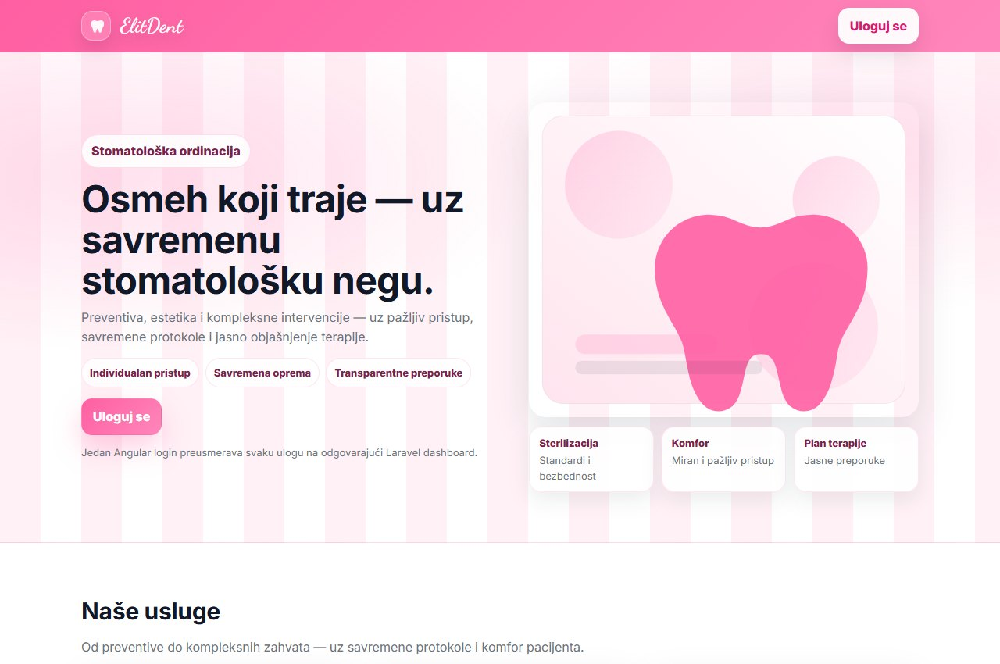

# ElitDent

**Dental practice information system · Information Systems and Internet Application Programming**

ElitDent combines a Laravel backend, Angular client and MySQL data model. Role-specific screens cover appointments, dentist schedules, patient records, and service and team administration.

## Source and analysis

- `app/`, `routes/` and `resources/views/`: Laravel controllers, role checks, API endpoints and server-rendered views.
- `frontend/`: Angular client for authentication and selected patient workflows.
- `database/migrations/`: MySQL schema.
- `docs/`: [Original seminar paper (DOCX)](docs/ISElitDent-documentation.docx) and [EER diagram](docs/eer-model.png).

The Serbian seminar paper covers requirements, Structured Systems Analysis, context and decomposition diagrams, a data dictionary, an EER model, and the relational schema. It describes the intended system. A requirement or diagram in the paper does not establish that a corresponding feature, such as billing, was implemented.

## Booking demo mode

[Open the live frontend demo ↗](https://indzo-elitdent-demo.vercel.app/)

**Interactive frontend demo · Fictional data · No live backend**

Choose a sample service, team, day, and time in the original Angular scheduler. Actions stay in browser memory and reset on refresh. This repository also contains the actual Laravel application and MySQL migrations. The seminar paper describes the proposed system, and the source implements workflows beyond the demo.

To run the demo locally, run `npm ci` and `npm run build:demo` in `frontend/`, then serve `dist/frontend/browser/` with a static web server.

## Local development

Use PHP 8.4, Composer, Node.js 22 or later, npm, and your own MySQL database.

1. Run `composer install`. Copy `.env.example` to `.env`, enter the local database settings, then run `php artisan key:generate` and `php artisan migrate`.
2. In `frontend`, run `npm ci` and `npm run build`. Copy the contents of `frontend/dist/frontend/browser/` to `public/app/`.
3. Run `php artisan serve` and open `http://127.0.0.1:8000/`. Keep the instance local and use synthetic records only.

The public copy omits patient data, database dumps and default privileged accounts. The Angular build and local Laravel landing page were checked; clinical workflows were not tested end to end.

